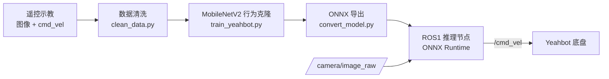
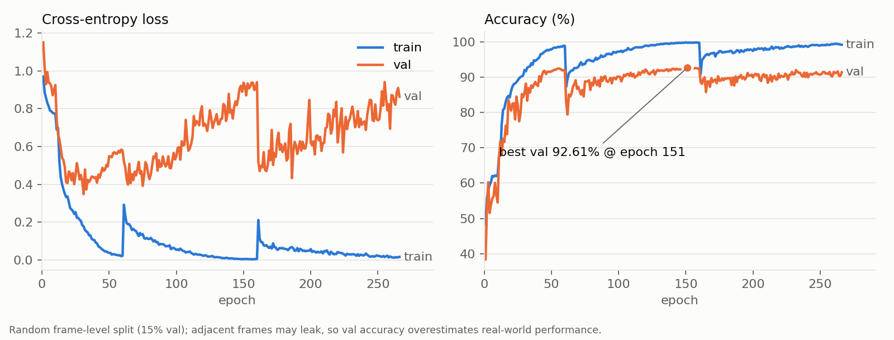

# Yeahbot：基于视觉行为克隆的移动机器人避障策略与 ROS 部署

用单目摄像头图像直接预测小车的速度指令。人工遥控小车采集“图像—速度指令”示教数据，训练轻量 CNN 策略（MobileNetV2），导出 ONNX 后部署到树莓派上的 ROS1 节点，实现端到端的视觉闭环控制。

<!-- 演示视频：上传后替换下面这一行 -->
> 🎬 实机演示视频：待上传

## 任务

小车在场地中自主行驶，需要完成三种行为：

| 行为 | 触发 | 期望动作 |
| --- | --- | --- |
| 障碍物绕行 | 前方出现障碍物 | 左转 / 右转绕开，通过后回正直行 |
| 垃圾桶掉头 | 识别到垃圾桶 | 持续转向，原地掉头 |
| 终点停车 | 识别到红色篮子 | 停止，任务结束 |

## 方法



**动作离散化。** 示教时的速度指令只有四种取值，因此把控制问题建模为四分类：

| 类别 | linear_x (m/s) | angular_z (rad/s) |
| --- | --- | --- |
| 前进 | 0.113 | 0 |
| 左转 | 0 | +0.206 |
| 右转 | 0 | −0.206 |
| 停止 | 0 | 0 |

**数据。** 一次采集共 12,911 帧（前进 6,498 / 左转 2,215 / 右转 2,368 / 停止 1,830）。`clean_data.py` 按连续停止片段的长度清理歧义样本：删除开头的待机帧、短于 10 帧的瞬时停顿和长于 200 帧的长时间待机，只保留真正的“看到终点而停车”。清洗后剩 12,370 帧，停止类为 1,289 帧。

**模型与训练。**
- ImageNet 预训练的 MobileNetV2 主干，接 Dropout + 两层全连接分类头（约 3.4M 参数，适合树莓派 CPU 推理）。
- 类别不均衡：`WeightedRandomSampler` 加权采样，同时使用类别加权交叉熵。
- 数据增强：颜色抖动、轻微仿射、高斯模糊、随机擦除（模拟遮挡）。
- 分阶段微调：前 10 个 epoch 冻结主干只训分类头，之后全网络微调；学习率采用 `CosineAnnealingWarmRestarts`（T₀=50，T_mult=2）。

**部署。** `ros/inference_ros_node.py` 订阅相机图像，用 ONNX Runtime 推理后向 `/cmd_vel` 发布 `Twist`：
- 置信度低于阈值（默认 0.5）时不直接执行预测动作，而是半速直行，避免低置信度下的突然转向。
- “停止”需要连续 15 帧确认才真正停车并结束任务，防止单帧误判导致中途停下。

## 训练曲线



验证集最佳准确率为 92.61%（epoch 151），各类别为前进 95.9% / 左转 93.0% / 右转 96.1% / 停止 77.6%。曲线中两处尖峰来自学习率热重启。

**注意：** 训练集和验证集按帧随机划分，相邻帧高度相似，验证准确率会高估真实表现，不能等同于实车避障成功率。停止类准确率明显偏低，是后续需要改进的地方（见下文）。

## 目录结构

```
├── scripts/
│   ├── train_yeahbot.py      # 训练
│   ├── clean_data.py         # 停止样本清洗
│   ├── convert_model.py      # .pth → ONNX + model_meta.json
│   └── predict_onnx.py       # 不依赖 ROS 的离线推理示例
├── ros/
│   ├── inference_ros_node.py # ROS1 推理节点
│   └── launch/yeahbot_inference.launch
├── models/                   # 部署用 ONNX 模型（权重在 .onnx.data）与元信息
├── data/sample/              # 12 张示例帧（每类 3 张）及对应 CSV，展示数据格式
└── docs/
    ├── DEPLOYMENT_GUIDE.md   # 训练与部署的详细步骤
    ├── training_log.csv
    └── training_curves.png
```

完整数据集（约 1.3 万张图像）和训练检查点体积较大，没有放进仓库。

## 快速开始

**离线试跑（无需 ROS 和小车）：**

```bash
pip install onnxruntime numpy pillow
python scripts/predict_onnx.py          # 对 data/sample 中的示例帧推理，输出动作、置信度与速度指令
```

**训练（PC / 服务器）：**

```bash
pip install -r requirements.txt
# 数据放在 data/<采集日期>/，内含 data.csv 与 images/
python scripts/train_yeahbot.py --data_dir ./data/2026_0210 --epochs 300
python scripts/convert_model.py output/checkpoint_epoch151_best.pth --output_dir models --verify   # 导出 ONNX 与 model_meta.json
```

**部署（树莓派 + ROS1 Noetic/Melodic）：** 把 `ros/` 放进名为 `yeahbot_nav` 的 catkin 包，`models/` 复制到包内的 `models/` 目录，然后运行：

```bash
roslaunch yeahbot_nav yeahbot_inference.launch
```

话题名、置信度阈值、停车确认帧数都可以在 launch 文件中修改。详细步骤见 [docs/DEPLOYMENT_GUIDE.md](docs/DEPLOYMENT_GUIDE.md)。

## 局限与改进方向

- **评测：** 改为按采集片段划分训练 / 验证集，并在新场景中做独立的实车测试，统计任务成功率。
- **停止类：** 停止样本少且与“待机”画面易混淆，可以增加终点附近的示教数据，或者单独训练一个终点检测头。
- **时序信息：** 当前是单帧决策，可以引入帧堆叠或时序模型，提升转向的连贯性。
- **动作空间：** 从四分类扩展为连续速度回归，或加入动作平滑。

## License

[MIT](LICENSE)
